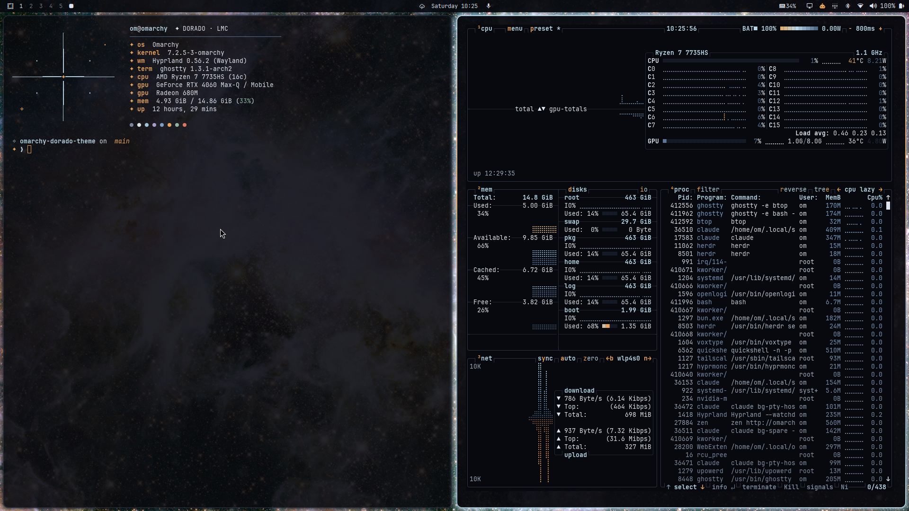
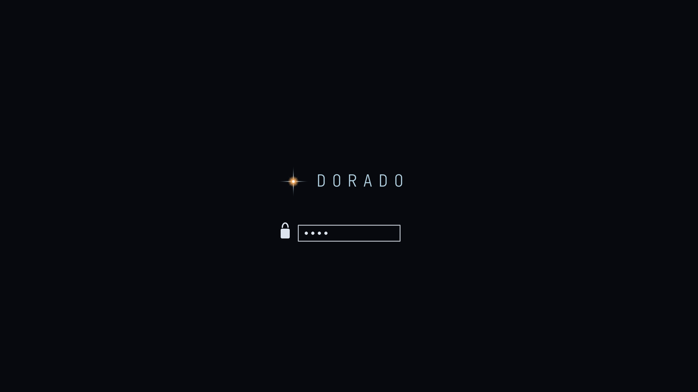

# Dorado Theme for Omarchy

A theme for [Omarchy](https://omarchy.org) sampled from the ESA/Hubble picture *A stormy stellar nursery* (N159 in the Large Magellanic Cloud). Dorado is the constellation that holds the Large Magellanic Cloud, and the word means "golden".

The palette pairs ion-core ice (`#b7d6e6`) with star gold (`#e8a35a`) on a deep-space background (`#07090e`):

- **Drifting border:** a 4-stop gradient (ice → storm blue → gold → ice) that rotates slowly, like ionised gas.
- **Condense motion:** windows settle in from 94% scale on a soft curve.
- **Focus depth:** focused windows at 0.95 opacity, unfocused at 0.88, so the nebula shows through.
- **Seven 4K wallpapers**, every one of them in Dorado.





## Install

Requires Omarchy 4 (uses `hyprland.lua` and `shell.toml`).

```bash
ln -s /path/to/omarchy-dorado-theme ~/.config/omarchy/themes/dorado
omarchy theme set dorado
```

Optional, for GTK apps:

```bash
omarchy hook install theme-set ~/.config/omarchy/themes/dorado/extras/50-gtk-css
omarchy theme set dorado
```

Optional extras:

```bash
# Starburst fastfetch
fastfetch -c ~/.local/state/omarchy/current/theme/extras/fastfetch.jsonc

# ✦ starship prompt
export STARSHIP_CONFIG=~/.local/state/omarchy/current/theme/extras/starship.toml
```

To show the starburst mark on the boot disk-unlock screen, open the Omarchy menu and choose Style › Unlock › dorado.

## What's included

| File | What it does |
|---|---|
| `colors.toml` | Ice and gold palette sampled from N159 |
| `hyprland.lua` | Rotating 4-stop border, `condense`/`drift` curves, 0.95/0.88 opacity |
| `shell.toml` | Bar, popups, tooltips, notifications, launcher, menu, polkit, lock and image picker at 0.93 alpha; gold for bar modules calling attention |
| `ghostty.conf`, `foot.ini` | Terminal palettes with 0.93 background opacity and a gold cursor |
| `gtk.css` | GTK 3/4 and libadwaita colors at 0.93 opacity |
| `btop.theme` | Meters rising from storm blue through ice to gold |
| `icons.theme` | `Yaru-blue-dark` |
| `extras/fastfetch.jsonc`, `extras/starburst.txt` | Fastfetch config with an ASCII diffraction-spike star |
| `extras/starship.toml` | Starship prompt with a gold ✦ |
| `extras/50-gtk-css` | Theme-set hook that links `gtk.css` into GTK 3 and 4 |
| `unlock.png`, `preview-unlock.png`, `extras/unlock.svg` | Starburst mark for the boot disk-unlock screen, and its source |
| `backgrounds/` | Seven 3840×2160 ESA/Hubble wallpapers |

## Wallpaper credits

All images are from [ESA/Hubble](https://esahubble.org) and licensed under [CC BY 4.0](https://creativecommons.org/licenses/by/4.0/). They have been cropped to 16:9 and resized to 3840×2160.

| File | Image | Credit |
|---|---|---|
| `0-n159-stormy-nursery.jpg` | [A stormy stellar nursery](https://www.esa.int/ESA_Multimedia/Images/2017/06/A_stormy_stellar_nursery) | ESA/Hubble & NASA |
| `1-n44-superbubble.jpg` | [A superbubble scene](https://esahubble.org/images/potm2608a/) | ESA/Hubble & NASA, D. Gouliermis |
| `2-tarantula-panorama.jpg` | [Hubble's panoramic view of a star-forming region](https://esahubble.org/images/heic1206a/) | NASA, ESA, ESO, D. Lennon and E. Sabbi (ESA/STScI), J. Anderson, S. E. de Mink, R. van der Marel, T. Sohn, and N. Walborn (STScI), N. Bastian (Excellence Cluster, Munich), L. Bedin (INAF, Padua), E. Bressert (ESO), P. Crowther (Sheffield), A. de Koter (Amsterdam), C. Evans (UKATC/STFC, Edinburgh), A. Herrero (IAC, Tenerife), N. Langer (AifA, Bonn), I. Platais (JHU) and H. Sana (Amsterdam) |
| `3-tarantula-outskirts.jpg` | [A Tarantula's outskirts](https://esahubble.org/images/potw2503a/) | ESA/Hubble & NASA, C. Murray |
| `4-r136-starforge.jpg` | [R136 observed with WFC3](https://esahubble.org/images/heic1605a/) | NASA, ESA, P. Crowther (University of Sheffield) |
| `5-tarantula-infrared.jpg` | [New Hubble infrared view of the Tarantula Nebula](https://esahubble.org/images/heic1402a/) | NASA, ESA, E. Sabbi (STScI) |
| `6-cosmic-cloudscape.jpg` | [Cosmic cloudscape](https://esahubble.org/images/potw2506a/) | ESA/Hubble & NASA, C. Murray |

## License

Theme code and configuration: MIT. Wallpapers: CC BY 4.0, credited above.
